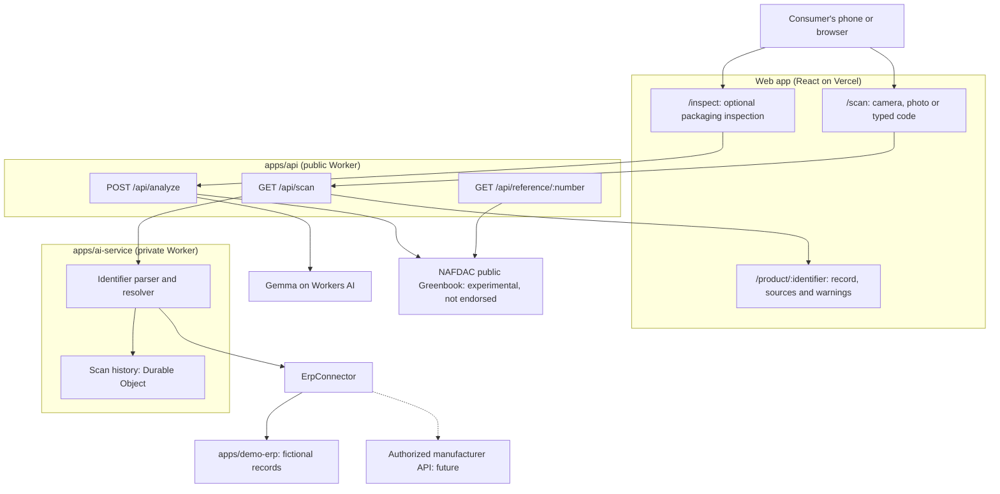

# CounterfeitIQ V3 architecture

## Key decisions

- **No database or accounts.** There are no logins, and nothing here needs Supabase.
- **`ErpConnector` is the integration point.** A real manufacturer connection replaces the simulated ERP, and every report lists its sources.
- **Gemma takes no part in a scan.** It only reads packaging photos on `/inspect`, so scans use no AI quota.
- **Product, batch and pack stay separate.** Every pack of a product shares a plain barcode, so only a serialized pack can show a repeat scan.
- **A reload doesn't count as a scan.** Every `/api/scan` call is recorded, so the web app reuses the report for a reload or the back button. Opening a saved link does count.
- **Failures are never "not found".** If the source can't answer, the result is `UNAVAILABLE`.

## Scan history

Each serialized pack has its own Durable Object holding unsalted hashes, a count and two timestamps, erased 30 days after the last scan. It holds no IP address or name. See [erp-integration.md](erp-integration.md) for details and limits.

## Earlier work

The scratch-code, manufacturer portal and admin work was never merged. It is kept under the tags `archive/v2-frontend`, `archive/v2-backend-contracts` and `archive/v2-qa`. The state of `main` before V3 is tagged `archive/pre-v3-main`.
