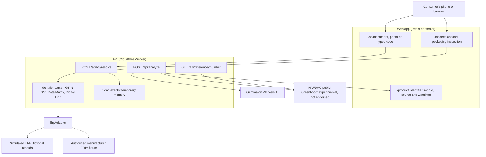

# CounterfeitIQ V3 architecture

## Key decisions

- **No database or accounts.** There are no logins, and nothing here needs Supabase.
- **`ErpAdapter` is the integration point.** A real manufacturer connection replaces the simulated adapter, and the response labels which kind of source answered.
- **Product, batch and pack stay separate.** Every pack of a product shares a plain barcode, so only a serialized pack can show a repeat scan.
- **Only fresh scans count.** Reloads and the back button don't record a scan event.
- **Failures are never "not found".** If the source can't answer, the result is `UNAVAILABLE`.

## Scan event limits

Events are held in memory by each Worker instance, and hold a code, a time, the identity level and a random per-tab ID. They hold no IP address or personal details. They reset when an instance restarts and aren't shared between instances, so repeat counts can be too low. The app tells people this next to any repeat count. Real tracking would need durable storage and a proper risk model.

The contract is in [`packages/shared/v3.ts`](../packages/shared/v3.ts).

## Earlier work

The scratch-code, manufacturer portal and admin work was never merged. It is kept under the tags `archive/v2-frontend`, `archive/v2-backend-contracts` and `archive/v2-qa`. The state of `main` before V3 is tagged `archive/pre-v3-main`.
